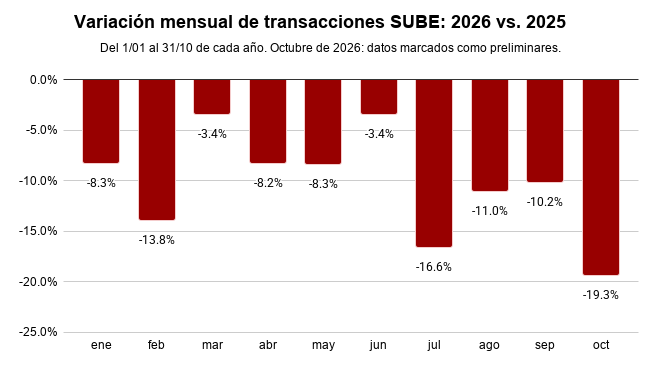

# SUBE: variación de transacciones, 2026 vs. 2025

Comparación de la cantidad de transacciones de la tarjeta SUBE entre los mismos días (del 1/01 al 31/10) de 2025 y 2026, con datos abiertos de datos.gob.ar.

**Pregunta:** ¿cómo varió el uso de SUBE en los primeros 10 meses de 2026 respecto de 2025: en total, mes a mes y por provincia?

## Resultado principal

Las transacciones pasaron de **3.282.548.543** (2025) a **2.943.958.445** (2026): una baja de **10,31%** (-338.590.098).

## Hallazgos

- Todos los meses de 2026 quedaron por debajo del mismo mes de 2025. La baja más chica fue en marzo y junio (-3,4%) y la más grande en octubre (-19,3%), seguida de julio (-16,6%) y febrero (-13,8%).
- Octubre de 2026 está marcado como preliminar en los datos, así que su variación puede cambiar (ver Limitaciones).
- Buenos Aires, que concentra el 37,5% de las transacciones de 2025, bajó 16,05%.
- La Jurisdicción Nacional (JN), con el 34,4% de 2025, bajó 11,00%.
- Entre las provincias, las bajas más fuertes fueron Chaco (-29,23%) y Neuquén (-26,48%).
- Solo subieron Córdoba, Santiago del Estero (+12,99%) y Tucumán (+6,64%). El +179,35% de Córdoba no es comparable (ver Limitaciones).

## Informe por provincia

Transacciones del 1/01 al 31/10. JN (Jurisdicción Nacional) no es una provincia y se muestra aparte. La variación de Córdoba no es comparable (ver Limitaciones).

| Provincia | 2025 | 2026 | Variación absoluta | Variación % |
|---|---:|---:|---:|---:|
| BUENOS AIRES | 1.231.992.557 | 1.034.217.531 | -197.775.026 | -16,05% |
| CABA | 308.873.990 | 305.017.270 | -3.856.720 | -1,25% |
| CATAMARCA | 11.433.771 | 9.591.648 | -1.842.123 | -16,11% |
| CHACO | 14.574.051 | 10.314.511 | -4.259.540 | -29,23% |
| CHUBUT | 21.197.780 | 18.740.047 | -2.457.733 | -11,59% |
| CORDOBA | 23.669.191 | 66.120.341 | +42.451.150 | +179,35% |
| CORRIENTES | 18.947.951 | 15.645.408 | -3.302.543 | -17,43% |
| ENTRE RÍOS | 20.899.570 | 18.652.567 | -2.247.003 | -10,75% |
| FORMOSA | 3.949.154 | 3.577.168 | -371.986 | -9,42% |
| JUJUY | 47.939.668 | 45.222.281 | -2.717.387 | -5,67% |
| LA PAMPA | 2.076.488 | 1.807.495 | -268.993 | -12,95% |
| MENDOZA | 170.188.371 | 163.899.920 | -6.288.451 | -3,69% |
| NEUQUÉN | 26.757.856 | 19.672.123 | -7.085.733 | -26,48% |
| RÍO NEGRO | 12.977.863 | 11.734.948 | -1.242.915 | -9,58% |
| SAN JUAN | 71.885.784 | 62.287.812 | -9.597.972 | -13,35% |
| SAN LUIS | 10.157.894 | 8.605.578 | -1.552.316 | -15,28% |
| SANTA CRUZ | 1.854.940 | 1.755.735 | -99.205 | -5,35% |
| SANTA FE | 125.618.671 | 113.489.382 | -12.129.289 | -9,66% |
| SANTIAGO DEL ESTERO | 638.847 | 721.835 | +82.988 | +12,99% |
| TIERRA DEL FUEGO | 6.271.765 | 5.143.799 | -1.127.966 | -17,98% |
| TUCUMAN | 20.688.904 | 22.063.481 | +1.374.577 | +6,64% |
| JN | 1.129.953.477 | 1.005.677.565 | -124.275.912 | -11,00% |
| **Total** | **3.282.548.543** | **2.943.958.445** | **-338.590.098** | **-10,31%** |

## Limitaciones

- **Datos preliminares:** en 2026, 295.407.943 transacciones (cerca del 10% del total del período) están marcadas como preliminares (`DATO_PRELIMINAR = SI`), incluido todo octubre. En 2025 no hay datos preliminares. La fuente puede corregirlos.
- **Córdoba:** SUBE empezó en Córdoba capital el 9/5/2025, por eso su variación (+179,35%) no es comparable.
- **JN:** Jurisdicción Nacional no es una provincia; pesa mucho y se muestra aparte.
- **Subte:** en los datos viene sin provincia (121.505.311 transacciones en 2025 y 109.605.288 en 2026, cerca del 3,7% del total). Se asignó a CABA porque el subte funciona solo en la ciudad: es una decisión del análisis, no un dato de la fuente.
- **CABA:** aparecía con dos nombres (`C.A.B.A` y `CIUDAD AUTÓNOMA DE BUENOS AIRES`) y se unificó.
- **Cobertura:** la columna `PROVINCIA` no incluye La Rioja, Misiones ni Salta, por lo que el informe no las muestra.
- **Mismos días:** el archivo de 2026 llega hasta el 2/11; se cortó al 31/10 para comparar los mismos días en ambos años.
- **Alcance:** `CANTIDAD` cuenta transacciones, no personas ni viajes. El análisis describe cuánto varió el uso, no explica por qué.

## Proceso y herramientas

1. **Linux (terminal):** revisión de los dos CSV con `head`, `tail` y `wc -l`.
2. **SQLite:** importación a la tabla `sube` y consultas (`consultas.sql`), verificando que ambos años cubren los mismos días y que los totales coinciden.
3. **Google Sheets:** informe por provincia (`SUMIFS`), tabla mensual y gráfico.

## Cómo reproducirlo

Descargar de datos.gob.ar los CSV de 2025 y 2026 (dataset "SUBE - Cantidad de transacciones (usos) por fecha"). No se incluyen en este repositorio por su tamaño. Con los archivos `dat-ab-usos-2025.csv` y `dat-ab-usos-2026.csv` en la carpeta:

~~~bash
sqlite3 sube.db "CREATE TABLE sube (DIA_TRANSPORTE TEXT, NOMBRE_EMPRESA TEXT, LINEA TEXT, AMBA TEXT, TIPO_TRANSPORTE TEXT, JURISDICCION TEXT, PROVINCIA TEXT, MUNICIPIO TEXT, CANTIDAD INTEGER, DATO_PRELIMINAR TEXT);"
sqlite3 sube.db ".import --csv --skip 1 dat-ab-usos-2025.csv sube"
sqlite3 sube.db ".import --csv --skip 1 dat-ab-usos-2026.csv sube"
sqlite3 sube.db "SELECT COUNT(*) FROM sube;"
~~~

Con los archivos descargados a principios de noviembre de 2026, el conteo da 1.046.028 filas (541.557 de 2025 y 504.471 de 2026). Después se pueden correr las consultas 2, 3 y 4 de `consultas.sql` (la 1 solo crea la tabla, que ya está creada arriba). La consulta 4 genera el resumen: se guarda con `sqlite3 -header -csv sube.db "CONSULTA_4" > sube_resumen.csv`, reemplazando CONSULTA_4 por esa consulta.

## Archivos

- `sube_resumen.csv`: transacciones por año, mes y provincia (440 filas).
- `consultas.sql`: consultas de SQLite.
- `grafico_variacion_mensual.png`: gráfico de variación mensual.

## Fuente

datos.gob.ar, dataset "SUBE - Cantidad de transacciones (usos) por fecha".
